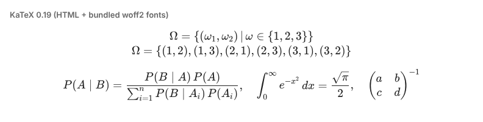
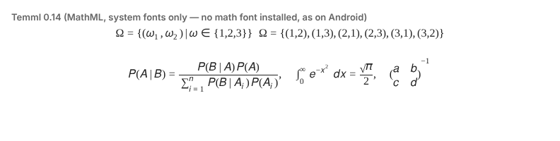
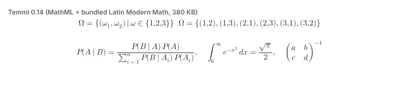
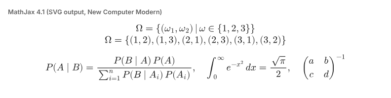

# Math blocks (#27): which renderer?

Issue [#27](https://github.com/experintellia/md-docs/issues/27) asks for `$$ … $$`
math blocks rendered the way fenced code blocks are. The editor side is the same
whichever library draws the math (see [Integration](#integration)); this compares
the renderers, because that choice decides how much the `.xdc` grows and where the
math looks right.

Measured 2026-10-11 against `main` at v0.3.1 (KaTeX 0.19.0, Temml 0.14.0,
MathJax 4.1.3). See [Method](#method) to repeat it.

## Recommendation

**KaTeX, with only the `woff2` fonts bundled.** Render `$$` blocks now, and leave
inline `$…$` for a follow-up.

- It's the only option that renders the issue's own example correctly *and* looks
  the same in every webview we target, including old ones, because its fonts ship
  inside the `.xdc` and its output is plain HTML and CSS.
- It costs **+336 KB** (`.xdc` 400 → 736 KB). That's a lot for this app, so two
  cheap trims are worth taking:
  - Load KaTeX with `import()` so a document without math never parses it. The
    measured main chunk stays at its current size and KaTeX goes in its own
    262 KB chunk.
  - Optionally, drop the rarely used font families (`\mathfrak`, `\mathscr`,
    `\mathsf`, `\mathtt`). Those then fall back to the system font. This brings
    the cost down to **≈ +256 KB**. `\mathcal` keeps its font, since it's common
    in probability notation like the issue's.

If even +256 KB is too much, the honest alternative is **Option D** (no renderer,
styled source), not Temml. Temml's small size only holds while it uses system
fonts, and on Android those make it look like the second screenshot below.

## Options at a glance

| | A. KaTeX | B. Temml | C. MathJax 4 | D. No renderer |
|---|---|---|---|---|
| Output | HTML + CSS + web fonts | MathML (the browser lays it out) | SVG paths | styled source |
| `.xdc` size (base 400.4 KB) | **736.4 KB (+336 KB)** woff2 only ≈656 KB (+256 KB) trimmed 1337.8 KB (+937 KB) as shipped | **469.9 KB (+70 KB)** system fonts 849.3 KB (+449 KB) with Latin Modern | **860.8 KB (+460 KB)**, core font ranges only | 400.4 KB (+0) |
| Issue example (top-level `\\`) | ✅ two lines (needs `strict: 'ignore'`) | ❌ one line: MathML Core drops the break | ✅ two lines | n/a |
| Older webviews (`chrome87` build target) | ✅ | ❌ no MathML before Chromium 109 | ✅ | ✅ |
| Same look on every device | ✅ fonts bundled | ❌ depends on installed math fonts | ✅ | ✅ |
| Render time per block (Node, issue example) | 0.9 ms | 0.3 ms | 6.9 ms | n/a |
| Bundling effort | import JS + CSS | import JS + CSS | ~8 deep imports; extra glyph ranges load dynamically and would need wiring up offline | none |
| License | MIT | MIT | Apache-2.0 | n/a |

The sizes are what each option adds to the real `.xdc`, built with this repo's
Vite config. They aren't npm package sizes.

## What each one looks like

All four render the same input in headless Chromium 141. The first line is the
issue's example, verbatim. The second line exercises a fraction, a sum, an
integral, a root and a matrix.

**A. KaTeX:** correct, with TeX-quality typesetting. The `\\` produces the two
lines the author meant.

**B. Temml, system fonts only:** this is what Android gets. As far as we can tell,
Android ships no font with an OpenType MATH table, and neither does this
container. The integral sign
shrinks, the matrix parentheses don't stretch, the glyphs are a sans-serif mix,
and the issue's two lines collapse into one.

**B′. Temml with Latin Modern Math bundled (380 KB):** the glyphs are fixed, but
the size is now above KaTeX's, and `\\` still doesn't break the line.

**C. MathJax 4 (SVG):** correct, and the closest to real LaTeX output, but it's
the heaviest and slowest option.

## Notes per option

### A. KaTeX: [katex.org](https://katex.org)

- As shipped, `katex.css` lists every font in three formats (woff2, woff, ttf), and
  Vite bundles all 59 files. Every webview we target reads woff2, so stripping
  the other two formats is pure savings (−601 KB). A short Vite `transform` on
  `katex.css` does this and keeps us on upstream's CSS across upgrades. It's
  better than keeping a vendored copy.
- In display mode LaTeX itself ignores a top-level `\\`. KaTeX breaks the line
  anyway but warns on every render, so pass `strict: 'ignore'`. Pass
  `throwOnError: false` too, so a half-typed `\frac{1}{` shows red source rather
  than throwing.
- Security: documents come from other chat members. Keep the default
  `trust: false` so `\href`, `\includegraphics` and `\htmlClass` stay disabled.
- Inherits `color`, so dark mode needs nothing extra.

### B. Temml: [temml.org](https://temml.org)

- A KaTeX fork that emits MathML and leaves layout to the browser. It's the
  smallest and fastest option, *if* the browser has a math font and a MathML
  engine.
- Chromium gained MathML only in version 109 (2023). Our build targets
  `chrome87`/`safari14` because some messenger webviews are that old. On those,
  Temml output renders as unstyled inline text.
- Temml's own README says: *"Chromium has some rendering bugs when using system
  fonts. It works better with the Latin Modern font, a 380 KB file."* Bundling
  that font removes the size advantage.
- The `\\` in the issue would need preprocessing (wrap the block in
  `\begin{gathered}`) to break.

### C. MathJax 4: [mathjax.org](https://www.mathjax.org)

- The reference implementation, with the broadest LaTeX coverage and good
  accessibility tooling.
- It was built for loading from a CDN. Bundling it offline means deep-importing
  the core, input, output, adaptor and package modules. The SVG font also loads
  extra glyph ranges on demand, which an offline `.xdc` can't fetch, so those
  would have to be bundled and registered by hand (more size than measured
  here).
- At about 7 ms per block, a document with many formulas gets noticeably slower
  to open.

### D. No renderer: styled source

- Parse `$$` blocks so they get a monospace, code-block-like box and are never
  mangled by other markdown rules. They aren't typeset.
- It costs zero bytes, and it's step 1 of every other option anyway: this is
  what a block looks like before a lazily loaded renderer arrives, and while the
  cursor is inside it.

### Not considered further

- **MathLive** is a math *editor* (virtual keyboard and all): 840 KB of minified
  JS on top of KaTeX's fonts. It's far more than display rendering needs.
- **KaTeX with `output: 'mathml'`** has the same MathML drawbacks as Temml, with
  worse MathML than Temml produces.
- **Native MathML without a converter:** people type LaTeX, not MathML, so a
  converter is unavoidable.

## Integration

This part doesn't depend on the renderer. It follows the table widget
(`tableField` in `src/live-preview/decorations.ts`) and is about 100 lines plus
tests:

1. A `@lezer/markdown` block-parser extension that turns `$$ … $$` into a
   `MathBlock` node, passed as `markdown({ …, extensions: [mathBlock] })` in
   `src/editor.ts`. Without it, today's parser reads the block as a paragraph and
   treats `\{`, `\\` and `_` as markdown.
2. A `StateField` that replaces each `MathBlock` with a block widget, and shows
   the raw source while the selection touches the block (the same reveal rule
   tables use).
3. A `MathWidget` whose `eq()` compares the source text, so only edited blocks
   re-render. The renderer is loaded with `import()` the first time it's needed.

`$$` is the syntax Obsidian, GitHub, Pandoc and Typora use, so documents stay
portable.

**Inline `$…$` (follow-up):** this needs the same renderer, so no extra bytes,
plus an inline parser with Pandoc's rules: no space after the opening `$` or
before the closing one, and no digit right after the closing `$`. Those rules
keep "costs $5 and $10" as plain text.

## Method

- **Size:** each library was imported into `src/main.ts` along with a call that
  renders a formula, so tree-shaking can't drop it. Then `npm run build` and
  `stat` on `dist-release/md-docs.xdc`. KB = 1024 bytes, as in the PR preview
  comment.
- **Render time:** `renderToString` (or MathJax `convert`) on the issue's
  example in Node 22, averaged over 200 runs after one warm-up.
- **Screenshots:** standalone pages for each library in Playwright's
  Chromium 141, on a Linux container with no math fonts installed.
- **Not yet checked on real devices.** Before merging an implementation, open the
  `.xdc` in Delta Chat on Android, iOS and desktop.
